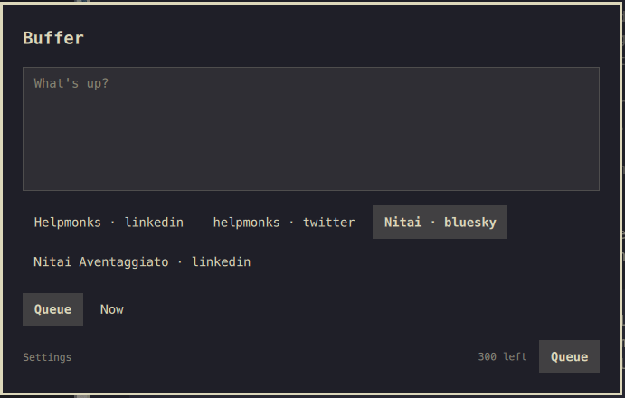

# omabuffer

Post to Buffer from anywhere on Omarchy. Hit a global shortcut, pick your
channels, type, Enter — queued or published immediately through the
official Buffer CLI. A tiny composer overlay for the Omarchy Quattro shell.



## Features

- **Bar icon and global shortcut** composer overlay — summon from either, Esc closes
- **Any connected channel** — pick one or several channels by clicking the
  chips; the multi-selection is remembered. One post is created per channel
  (Buffer's API posts to a single channel per call), each with the link
  card attached where its network supports one
- **Fast, resilient startup** — connected channels are cached for seven days,
  shown immediately after a restart, and kept available if a background
  refresh cannot reach Buffer
- **Background posting** — the composer closes the moment you hit post;
  the outcome arrives as a system notification. Failures keep the draft so
  you can correct and retry
- **Queue or publish now** — add to the channels' Buffer queue or post
  immediately, one toggle
- **Link cards** — paste a URL and attach a link card; Buffer fetches the
  page (including its image) when the post goes out. Supported on Bluesky,
  LinkedIn, Facebook and Threads; X/Twitter unfurls links natively
- **Daily limit check** — before every post all selected channels' daily
  posting limits are checked in one call, and used-up channels are named
  up front
- **Per-channel character counter** — counts the way each selected network
  counts (Bluesky graphemes, LinkedIn URLs as 24, X URLs as 23) and shows
  the tightest remaining allowance across the selection

## Install

```sh
omarchy plugin add https://github.com/thenitai/omabuffer.git --enable
```

During installation you are asked where to place the bar icon — left,
center or right (the right side is the preselected default). To move it
later:

```sh
omarchy plugin enable thenitai.omabuffer --section center
```

Then install the Buffer CLI (Node 18 or later):

```sh
npm install -g @bufferapp/cli
```

With a Node version manager such as mise, global packages belong to a Node
version. After upgrading Node, rerun the install command above and reopen
the composer. The plugin checks that the CLI can start, so a leftover shim
shows the installation instructions instead of being treated as ready to post.

## Setup

1. Create an API key at **publish.buffer.com → Settings → API**.
2. Click the Buffer bar icon or press the composer shortcut — the first run
   shows the setup form. Paste the API key and hit *Save & verify*.
3. Pick the channels to post to directly in the composer; multi-select is
   remembered across opens and restarts.

Connected channels and the Buffer organization ID are cached in
`~/.config/omarchy-buffer/prefs.json`. The plugin refreshes that cache after
seven days while continuing to show stale channels if Buffer is unavailable.
Use **Settings → Channels → Refresh channels** to refresh it immediately.

The API key is stored in `~/.config/omarchy-buffer/api-key` (directory mode
`0700`, the key file `0600`) and is handed to the Buffer CLI through its
`BUFFER_API_KEY` environment variable — never through the command line —
so it never shows up in a process list.

## Global shortcut

The composer opens with **SUPER + ALT + B** by default. The plugin registers
it with Hyprland at runtime (via `hyprctl eval`), so no manual binding is
needed; it is re-applied whenever the shell starts or Hyprland reloads its
config.

Change it in the plugin's **Settings** view: type a combo like
`SUPER + SHIFT + P` and hit *Apply*. Combos already assigned to another
Hyprland action are rejected with the conflicting action's name, and
leaving the field empty disables the shortcut. The choice persists across
restarts.

## Bar icon

The Buffer icon on the bar opens (or closes) the composer — a discoverable
fallback for when the global shortcut is disabled or unavailable. Its
section is chosen during installation; see above for how to move it later.

## Keyboard

| Key | Action |
| --- | --- |
| `Esc` | Close (draft is kept) |
| `Ctrl+Enter` | Post (composer closes; the post is sent in the background) |
| `Ctrl+V` / `Shift+Insert` | Paste clipboard text, replacing the selection |
| Middle click | Paste the primary selection at the pointer |
| Right click | Editing menu, including bounded paste |
| `Ctrl+A/C/X/Z` | Standard text editing |
| `Super+A/V/C/X/Z` | Same, for Super-mapped system shortcuts — requires the triggering Hyprland bind to opt in with `{ allow_input_capture = true }` |
| Click outside | Close |

Clipboard reads in the composer and settings run asynchronously through
`wl-paste` in a separate process, using the system Python 3 included with
Omarchy. Each read has a **2-second total deadline** and a **64 KiB combined
stdout/stderr limit**, checked before any text reaches the shell. Oversized,
failed, or timed-out reads insert nothing and show an error. Editing or
closing the field cancels an outstanding read. Only plain text is inserted;
keyboard, context-menu and middle-click paste all use the same limits.

Settings keep their native Qt text controls permanently read-only, with
direct keyboard edits handled separately. This prevents Qt's automatic
clipboard-change checks from fetching foreign text, even while settings
are hidden. Selection, password masking, cut/copy, undo/redo and bounded
paste are preserved. Use paste for IME-composed text in settings; the post
composer retains native input-method support.

## CLI notes

Everything goes through the `buffer` CLI (`@bufferapp/cli` on npm), which
wraps Buffer's public GraphQL API:

- `buffer account` — API key verification and organization lookup
- `buffer channels list` — the channel picker
- `buffer dailyPostingLimits list` — pre-flight check for every selected
  channel in one call, before each post
- `buffer posts create --input -` — the post itself, one call per selected
  channel (Buffer's API targets a single channel per post), with the
  payload piped through stdin (nothing user-typed ever appears in `argv`)

Each API-backed CLI request runs through a Node wrapper with a 30-second
deadline and a 1 MiB combined stdout/stderr limit, enforced before output
reaches the shell. Exceeding either limit kills the request process group
and returns a bounded error. A failed post retains the draft; check Buffer
before retrying because a timed-out or oversized-response post may already
have been accepted.

Errors are surfaced from the CLI's structured JSON output; auth failures
(issued or expired keys) reopen the setup form, mutation errors (for
example the server-side limit check) are shown inline.

Not implemented (yet): images and video (Buffer requires media to live at
a public URL), threads, reply/quote behavior, scheduled-at times, drafts
and ideas.

## Tests

Run `node --test tests/*.test.cjs`. The Qt tests run offscreen in Quickshell
and require Qt 6 development headers, QtTest, `g++` and `pkg-config`. A
test-only clipboard provider counts payload requests to catch automatic
clipboard reads without a paste gesture. Tests use synthetic clipboard
data and do not access the desktop clipboard, credentials or Buffer API.

## Remove

```sh
omarchy plugin remove thenitai.omabuffer
rm -rf ~/.config/omarchy-buffer   # API key and preferences
```

Revoke the API key in publish.buffer.com settings when you're done.

## License

MIT
